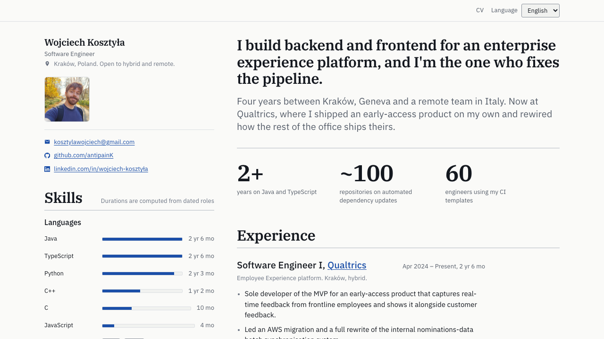

# antipaink.github.io

Personal portfolio of **Wojciech Kosztyła** — Software Engineer.
Built with React, TypeScript, and Vite, with first-class internationalization.

🔗 Live: https://antipaink.github.io/



## Tech stack

- **Vite** + **React** + **TypeScript** (strict)
- **react-router** for `/`, `/cv`, `/projects/:slug`
- **CSS Modules** for scoped, zero-runtime styling
- **react-i18next** — two languages (English, Polski); typed keys derived from `en`
- **Vitest** + **React Testing Library**
- **ESLint** flat config (`@stylistic` for formatting — no Prettier)
- **Playwright** (dev-only) for build-time prerendering — see [Routing & prerendering](#routing--prerendering)
- **GitHub Actions** → **GitHub Pages**

## Prerequisites & setup

Requires **Node 24** (see `.nvmrc`) and **pnpm**. Node is managed with
[fnm](https://github.com/Schniz/fnm), the same on macOS and Windows.

1. Install fnm and pnpm:
   - macOS: `brew install fnm pnpm`
   - Windows: `winget install Schniz.fnm pnpm.pnpm`
2. Make fnm switch Node automatically when you `cd` into a folder with an `.nvmrc`. Add one line
   to your shell's startup file:
   - macOS (zsh), in `~/.zshrc`: `eval "$(fnm env --use-on-cd --shell zsh)"`
   - Windows (PowerShell), in the file `$PROFILE`. Create it if missing, without `-Force` (which
     would empty an existing one):
     `if (!(Test-Path $PROFILE)) { New-Item -ItemType File -Path $PROFILE }`, then
     `notepad $PROFILE` and add the line `fnm env --use-on-cd | Out-String | Invoke-Expression`

   Then open a new terminal.
3. From the repo root: `fnm install` (once, installs the Node version from `.nvmrc`).

If a plain `pnpm` command prompts "Corepack is about to download…", an old Corepack shim is
shadowing your pnpm: run `corepack disable` once in each Node version you use.

No Corepack is needed. `package.json` pins a pnpm version in `packageManager`, and pnpm itself
reads that field.

## Install & run

```sh
pnpm install     # install dependencies
pnpm dev         # start the dev server (http://localhost:5173)
pnpm build       # type-check and build to dist/
pnpm preview     # serve the production build locally
```

## Scripts

| Script | Description |
| --- | --- |
| `pnpm dev` | Start the Vite dev server |
| `pnpm build` | Type-check (`tsc -b`) and build for production |
| `pnpm preview` | Preview the production build |
| `pnpm lint` | Run ESLint |
| `pnpm lint:fix` | Run ESLint with `--fix` |
| `pnpm test` | Run Vitest in watch mode |
| `pnpm test:ci` | Run Vitest once (CI mode) |
| `pnpm typecheck` | Type-check without emitting |
| `pnpm prerender` | Build-time prerender (`dist/` must already exist — run `pnpm build` first) |
| `pnpm test:visual` | Pixel-diff the homepage against the committed baseline for your OS (`dist/` must already exist) |
| `pnpm screenshots:update` | Regenerate every screenshot output, incl. `docs/homepage-preview.png` and the visual baseline for your OS (`dist/` must already exist) |

One-time per machine before the first `pnpm prerender` or `pnpm test:visual`:
`pnpm exec playwright install chromium`.

## Project structure

```
src/
  App.tsx                  # AppRoutes (/, /cv, /projects/:slug) + BrowserRouter
  pages/                   # routed page components (HomePage, CvPage, ProjectPage)
  hooks/useDocumentHead.ts # sets per-route <title>/OG tags, captured by the prerender snapshot
  data/
    portfolio.ts           # typed, language-invariant facts (experience, education, skills)
    projects.ts            # projects shown on /projects/:slug (empty for now)
  i18n/
    config.ts              # SUPPORTED_LOCALES, DEFAULT_LOCALE, LOCALE_LABELS
    resources.ts           # assembles i18next resources from the locale files
    keys.ts                # TRANSLATION_KEYS + TranslationKey / TranslationListKey (derived from en)
    useTranslation.ts      # typed t() wrapper, plus tList() for bullet lists
  locales/
    en.ts                  # canonical translations (source of truth)
    pl.ts                  # PartialTranslations — missing keys fall back to en
  components/
    layout/                # Layout (owns the skill filter), Header, Rail, Footer, LanguageSwitcher
    sections/              # Hero, ExperienceTimeline, SkillsSection, EducationList
  lib/
    date.ts, duration.ts   # date and whole-month formatting
    skills.ts              # data-agnostic duration / last-used / lookup helpers
    skillFilter.ts         # the same logic bound to the real catalog and timeline
  tokens.css               # design tokens — the only file with raw colour values
  index.css                # global reset and element defaults
scripts/
  deriveRoutes.ts          # pure route-list derivation, used by prerender.mjs
  prerender.mjs            # build-time prerender (see Routing & prerendering below)
  screenshotDiacritics.mjs # renders the Polish pangram to check latin-ext loads
  screenshotReadme.mjs     # regenerates docs/homepage-preview.png shown above
  lintFixEditedFile.mjs    # Claude Code hook: eslint --fix on the file just edited
e2e/
  visual.spec.ts           # pixel-diff of the homepage (clock frozen); baselines per OS beside it
playwright.config.ts       # config for the visual test (not used by prerender.mjs)
```

Facts (dates, company names, tech tags, links) live in `data/portfolio.ts`/`data/projects.ts`; the
translatable prose lives in the typed `locales/*.ts` objects. Components reference
keys via `TRANSLATION_KEYS.common.nav.experience` and never touch a language — the
i18n layer resolves the current locale (falling back to `en`). Imports use path
aliases: `@i18n`, `@components`, `@data`, `@lib`, `@locales`, `@pages`.

## Routing & prerendering

Three routes today: `/` (homepage), `/cv` (placeholder — a real dense CV layout is future work),
`/projects/:slug` (scaffolded — `data/projects.ts` is empty, so every slug currently renders "not
found"). GitHub Pages is a static host with no server-side rewrites, so a client-side router alone
would 404 on a direct hit or refresh to `/cv`. The fix: after `pnpm build`, `pnpm prerender` (uses
Playwright + Vite's `preview()` API) visits every real route and writes the fully-rendered HTML to
`dist/<route>/index.html`, so GitHub Pages serves genuine content per route — the shipped JS still
renders over it client-side exactly like a normal SPA. CI runs this automatically
(`.github/workflows/deploy.yml`). Full mechanics, gotchas, and how to add a project:
[`docs/routing-and-prerendering.md`](docs/routing-and-prerendering.md).

## Adding a language

1. Add `src/locales/<lng>.ts` exporting a const `satisfies PartialTranslations<Translations>`
   (it may be partial — missing keys fall back to `en`).
2. Register the locale in `src/i18n/config.ts` (`SUPPORTED_LOCALES`, `LOCALE_LABELS`).
3. Add it to `resources` in `src/i18n/resources.ts`.

## Deployment

Every push to `master`, and a weekly schedule (Mondays), runs lint, type-check, tests, and build,
then installs Chromium and runs the prerender step, then deploys to GitHub Pages via GitHub Actions
(`.github/workflows/deploy.yml`). The weekly run keeps build-time values such as skill durations
current.
Enable it once under **Settings → Pages → Source: GitHub Actions**.
